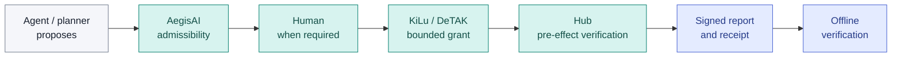

<p align="center">
  
</p>

<p align="center">
  <strong>Authority for autonomous execution</strong><br/>
  <sub>An evidence-first field guide to AI-agent permissions, human approval, bounded execution and verifiable outcomes.</sub>
</p>

<p align="center">
  <a href="README_RU.md">Русский</a> ·
  <a href="docs/00_START_HERE.md">Start here</a> ·
  <a href="evidence/CLAIMS_REGISTER.csv">Claims register</a> ·
  <a href="docs/11_THREAT_MODEL.md">Threat model</a> ·
  <a href="docs/06_REVIEW_PROTOCOL.md">Technical review</a> ·
  <a href="LEGAL.md">Rights & IP</a>
</p>

<p align="center">
  <a href="https://github.com/IkaRiche/KiLu-Scientific-Technical-Due-Diligence/actions/workflows/validate.yml"></a>
  
  
</p>

---

> **An AI agent should not be its own execution authority.**
>
> The model proposes. Policy determines admissibility. A human may approve. KiLu issues bounded authority. A Hub validates it **before** an effect. A receipt then supports a narrowly defined after-the-fact check.

**KiLu** is an execution-authority research and engineering program. This repository is its **public, sanitized scientific and technical due-diligence index**: what exists, what was actually tested, what remains unverified and how a reviewer can challenge each claim. It follows the evidence discipline of the [STASYS/LMA public review](https://github.com/IkaRiche/LMA-Scientific-Technical-Due-Diligence), without importing LMA mechanisms or presenting these products as a single proven system.

**Not a source-code release. Not a commercial offer. Not evidence of universal AI safety.** Primary proprietary code and raw experimental records remain under the rights holder's custody.

## The problem in one diagram



*Architecture and intended trust handoffs, **not** a claim that one deployed and independently audited end-to-end chain has already been established. AegisAI adjudicates; KiLu authorizes; the Hub executes. None of these roles may be silently substituted for another.*

## Four things worth evaluating

| Property | What it could solve | Evidence boundary |
|:--|:--|:--|
| **Authority separated from the agent** | A prompt or planner output is not itself permission to perform an effect | Explicit architecture; deployed coverage is lane-specific |
| **Bounded permission** | Action, target runtime, time window and one-use semantics can be checked at an executor boundary | Scoped Cloud/SQLite and compiled-Linux-Hub tests reported internally |
| **Human-controlled escalation** | Higher-risk operations can require a visible approval step | Earlier Android approval milestones reported; **experimental V2** has JVM tests, not a completed physical-device V2 ceremony |
| **Verifiable outcome trail** | Correlate a grant, execution report, receipt and independent verification | Scoped cross-language private CI; not proof of every physical effect or deployment |

See [evidence inventory](evidence/INDEX.md), [execution tests](docs/04_EXECUTION_EVIDENCE.md) and [negative claims](docs/09_LIMITATIONS_AND_RISKS.md).

## Evidence at a glance

| Evidence lane | What the evidence supports | What it does **not** support |
|:--|:--|:--|
| **Historical R1/E2/E3.2** | Owner-reported Android approval, Hub task execution, grant/revoke milestones | New exact-action V2 approval on a physical device |
| **CREG-001 / CREG-002** | Synthetic Cloud → compiled Linux Hub → scoped effect → signed receipt → Go Offline Verifier; single authorized CI effect | Global exactly-once effects, actual production rollout, a live AegisAI policy decision |
| **CREG-003** | Exact-payload V2 signing format across Android JVM and Cloud/SQLite; negative controls for substitutions and scope drift | Hardware-enforced Ed25519 biometric key custody, fully integrated AegisAI Class A authorization |
| **Public SDK** | Evaluation-stage integration examples and documented interfaces | Mock `ALLOW` or legacy `/v1/intent` as an executable grant |

**Key distinction:** a green workflow verifies only its assertions. The private CI record is **owner-reported** to a reader who cannot inspect it. Public reviewers can verify the [Android JVM run](https://github.com/IkaRiche/kilu-pocket-agent/actions/runs/42079529380), the [Android repository](https://github.com/IkaRiche/kilu-pocket-agent) and the [KiLu SDK](https://github.com/IkaRiche/kilu-sdk). Those public resources do not expose the complete closed-source authority engine.

## Start here — choose your review path

| You are… | Start with… | Decisive question |
|:--|:--|:--|
| **Infrastructure / platform architect** | [Architecture](docs/02_ARCHITECTURE_BOUNDARIES.md) · [Integration brief](docs/08_INTEGRATION_QUALIFICATION.md) | Where, exactly, is the last pre-effect authorization boundary? |
| **Security / governance reviewer** | [Threat model](docs/11_THREAT_MODEL.md) · [AegisAI](docs/03_AEGISAI_GOVERNANCE.md) | Can any actor cause a side effect without a valid bounded grant? |
| **Scientific / evidence reviewer** | [Claims register](evidence/CLAIMS_REGISTER.csv) · [Evidence standards](docs/12_PUBLIC_REPRODUCIBILITY.md) | Which assertion has a public primary artifact and which is internal-only? |
| **Technical buyer / counsel** | [Executive brief](docs/01_EXECUTIVE_OVERVIEW.md) · [Commercial diligence](docs/10_COMMERCIAL_DILIGENCE.md) | Which IP and evidence rights are actually transferable? |
| **Developer** | [Public SDK](https://github.com/IkaRiche/kilu-sdk) · [FAQ](docs/13_FAQ.md) | How do I avoid mistaking a demo or a policy decision for execution authority? |

Full documentation: [index](docs/INDEX.md). The machine-readable [claim register](evidence/CLAIMS_REGISTER.csv) includes positive, negative and unresolved statements.

## What we deliberately do not claim

- A single **independently verified live** AegisAI → real Android V2 → KiLu → Hub → offline receipt chain.
- Hardware-backed non-exportable **Ed25519** keys bound cryptographically to every biometric operation in the reviewed Android client.
- Full production qualification of the experimental CREG carrier, field safety, certification, independent penetration testing or universal exactly-once effects.
- That sample SDK integrations or legacy intent responses are execution grants.
- That KiLu, AegisAI, DeTAK and StasysOS are already a single proven deployed product.

The scope of public and withheld information is explicit in the [disclosure boundary](docs/07_DISCLOSURE_BOUNDARY.md). If a reviewer requires confidential primary evidence to verify a claim and cannot inspect it, the correct external conclusion is **EVIDENCE_INSUFFICIENT**, not PASS.

## Public review and contributions

Documentation errors, broken public links, claim mismatches and proposed **non-sensitive** review questions are welcome through GitHub issues. **Do not upload** private repositories, credentials, raw proof objects, unpublished inventions, production identifiers or customer records. This is not an invitation to test operational systems. See [CONTRIBUTING](CONTRIBUTING.md) and [SECURITY](SECURITY.md).

To verify only the **documentation integrity** locally:

```bash
python3 tools/validate_public_package.py
```

This validates controlled file inventory, evidence references and local links, not the underlying science, code security, patent position or private experiments.

## Ownership, disclosure and transaction perimeter

All rights reserved. The components have separate source, evidence and potential IP perimeters; definitive chain of title must be established from original legal records. Public access grants no technology license, patent rights or rights to confidential material. No buyer commitment, valuation or transfer terms are implied.

[Rights](LEGAL.md) · [Disclosure policy](docs/07_DISCLOSURE_BOUNDARY.md) · [Security](SECURITY.md)

<sub>Evidence cutoff: **5 November 2026** · Editorial status: public technical evidence index · Visuals are conceptual, not implementation schematics.</sub>
