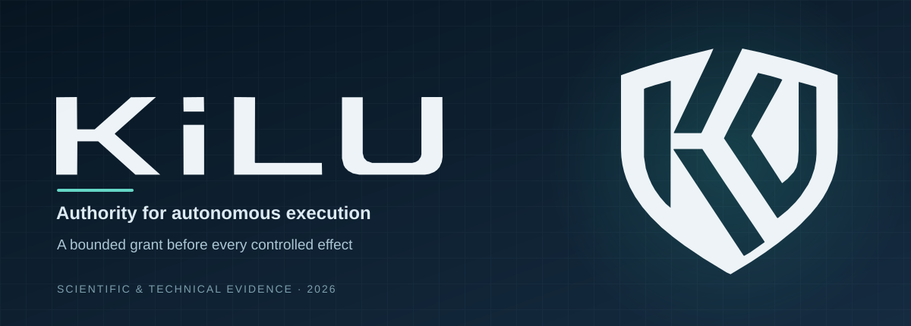
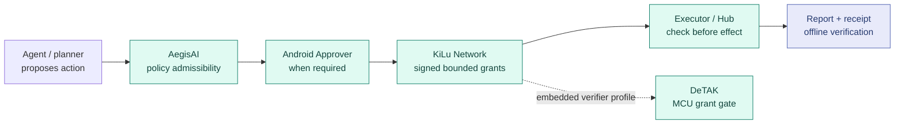

  

<h1 align="center">KiLu · Execution Authority for AI Agents</h1>

<strong>AI proposes. KiLu authorizes. The executor verifies.</strong>

Deterministic, cryptographically bounded control of AI-initiated actions — independent of what the model says or intends.

  <a href="README_RU.md">Русский</a> ·
  <a href="docs/01_EXECUTIVE_OVERVIEW.md">Technology value</a> ·
  <a href="docs/04_EXECUTION_EVIDENCE.md">Execution proof</a> ·
  <a href="docs/14_DETERMINISTIC_GATE_EVIDENCE.md">Benchmarks</a> ·
  <a href="docs/08_INTEGRATION_QUALIFICATION.md">Integration</a> ·
  <a href="evidence/CLAIMS_REGISTER.csv">Evidence register</a>

  
  
  

---

## Give AI agents capabilities — not unchecked authority

An autonomous agent can write code, operate tools, request payments or manage infrastructure. **Its proposed action must not be its permission to execute.**

**KiLu solves this at the execution boundary.** A separately governed authority issues a cryptographically signed, bounded grant. The executor checks that grant **before** taking the controlled action. A traceable report and receipt allow verification afterward.

**No LLM is required in the deterministic authorization gate.** Prompt injection can corrupt an upstream model's proposal, but it cannot directly instruct the KiLu/DeTAK gate to ignore policy, forge a signature or create a valid grant. Human approval keys remain outside the remote agent's environment in the split-trust design.

This is **infrastructure-level separation of intent from authority**, not another prompt-based guardrail.

## Measured engineering evidence

| Evaluated capability | Recorded outcome | Evidence class |
|:--|:--|:--|
| **Deterministic governance** | **10,000** AegisAI fixture decisions; **0.22 ms mean / 0.35 ms p95** | Internal, pinned no-LLM benchmark |
| **Adversarial governance cases** | **1,748** prompt-injection fixtures; **0** security failures by the recorded metric | Same internal benchmark |
| **Embedded cryptographic gate** | Ed25519 verification **~7.85 ms**; complete valid-grant gate **~7.933 ms** on STM32H7 | Internal physical MCU benchmark; separate timing boundary |
| **Anti-replay and runtime binding** | Signed grants, JTI consumption and wrong-action/runtime denial exercised | Scoped Cloud/SQLite + compiled Linux Hub CI |
| **Controlled execution & evidence** | **One authorized effect**, exact output, signed report, receipt and independent Go verification | CREG-002 one-shot, scoped internal CI |
| **Real Android approval history** | Earlier R1/E2 device approval and execution, followed by workflow grant/revocation milestones | Historical live validation records |
| **Exact-action V2** | Android JVM and Cloud/SQLite signature-binding and mutation tests passed | Public Kotlin CI; private Cloud CI |

These are **different tests of specific mechanisms**, not one combined latency SLA or a claim that an experimental V2 has already been deployed. Method, source access and precise boundaries: [Evidence register](evidence/CLAIMS_REGISTER.csv) · [Benchmark detail](docs/14_DETERMINISTIC_GATE_EVIDENCE.md).

## Why the architecture matters

| Ordinary agent-centric approach | KiLu's authority separation |
|:--|:--|
| Model is trusted to obey a prompt or decide when to call a tool | **Deterministic gate** checks policy and signed permission independently of the model |
| Agent holds broad reusable service credentials | **Bounded authority:** action/scope, runtime/toolchain, expiry and single-use JTI in the exercised lanes |
| Human approval is just a UI state or a message to the model | **Separate Approver:** human-controlled key on Android, not distributed to the agent |
| A log records what happened after an action | **Pre-effect enforcement + signed evidence:** decision, granted scope, report, receipt and offline checking |
| A general orchestration framework controls the whole workflow | **Composable authority layer:** the existing planner, workflow engine and executor remain independently replaceable |

**The design keeps an untrusted or compromised model from granting itself new execution powers on a properly enforced KiLu-controlled path.** The measured denial and replay tests support this separation within their tested configurations.

## Where the technology fits

- **AI infrastructure and agent platforms:** independently authorize tool calls, API mutations and hosted execution workflows.
- **Enterprise operations:** control code execution, privileged automation and approval-sensitive actions with evidence of authorization.
- **Financial and agentic transactions:** a deterministic authorization boundary between AI-initiated payment intent and the regulated financial rail. **Prospective integration use case**, not a claim of banking deployment or certification.
- **Embedded and autonomous systems:** DeTAK demonstrates grant verification on resource-constrained STM32H7 hardware; no remote LLM is necessary for its authorization decision.

[Technology overview](docs/01_EXECUTIVE_OVERVIEW.md) · [Buyer integration path](docs/08_INTEGRATION_QUALIFICATION.md) · [Technical ownership/transaction review](docs/10_COMMERCIAL_DILIGENCE.md).

## A deliberately separated trust architecture

*The diagram shows the separation of roles; each validation milestone has its own evidence scope. KiLu issues grants and receipts. AegisAI evaluates admissibility. The embedded DeTAK gate validates grants on the MCU path.*

## Explore the evidence

| Review interest | Recommended entry |
|:--|:--|
| Business value and acquisition relevance | [Executive overview](docs/01_EXECUTIVE_OVERVIEW.md) · [Commercial diligence](docs/10_COMMERCIAL_DILIGENCE.md) |
| Executable security mechanisms | [Trust architecture](docs/02_ARCHITECTURE_BOUNDARIES.md) · [Threat controls](docs/11_THREAT_MODEL.md) |
| Tested execution and anti-replay | [Execution evidence](docs/04_EXECUTION_EVIDENCE.md) · [Evidence inventory](evidence/INDEX.md) |
| Measured latency and prompt-injection boundary | [Deterministic gate evidence](docs/14_DETERMINISTIC_GATE_EVIDENCE.md) |
| Android key isolation and human approval | [Approval evidence](docs/05_APPROVAL_EVIDENCE.md) · [Public Android source](https://github.com/IkaRiche/kilu-pocket-agent) |
| Developers evaluating the integration surface | [KiLu SDK](https://github.com/IkaRiche/kilu-sdk) · [FAQ](docs/13_FAQ.md) |
| Verification, legal and disclosure conditions | [Review protocol](docs/06_REVIEW_PROTOCOL.md) · [Evidence scope](docs/09_LIMITATIONS_AND_RISKS.md) · [IP boundaries](LEGAL.md) |

## Technology and IP evaluation

KiLu is a **technology asset and infrastructure integration opportunity**, not merely an Android application. The product family includes distinct policy-governance, grant-authority, approval, execution, verification and embedded components with different maturity and IP ownership boundaries. Any acquisition, licensing or partnership perimeter must be defined explicitly.

This is an **intentional public technical overview**: proprietary implementation, primary raw evidence, keys and unpublished inventions remain under the rights holder's control. The dossier reports scoped results, public verification links and the criteria for deeper technical review.

[Start a review](docs/00_START_HERE.md) · [Technical verification](docs/06_REVIEW_PROTOCOL.md) · [All documents](docs/INDEX.md)

Evidence cutoff: 5 November 2026 · Public material for preliminary technical evaluation · All rights reserved. Documentation CI checks only this public dossier.
