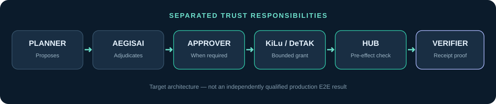

# Trust and responsibility boundaries

**Target architecture, not a completed full-stack qualification:** a proposed action enters policy adjudication, passes a human gate if required, becomes an executor-scoped grant, is checked before execution, then produces evidence and an offline-verifiable receipt.

- **Planner / external model:** proposes; never mints authority.
- **AegisAI:** assesses policy admissibility; Class A attestation of a decision is not an execution grant.
- **Human Approver:** explicitly confirms a presented proposal within a defined protocol; current V2 and historical approvals have different evidence scopes.
- **KiLu / DeTAK:** mints, scopes and validates authority; not a planner or executor.
- **Linux Hub:** performs the authorised effect only after validating the relevant signed token and replay boundary in the tested path.
- **Verifier:** confirms a scoped cryptographic receipt; it cannot independently observe every external physical consequence.
- **StasysOS:** separate complementary runtime, not silently merged into KiLu's experimental evidence.

The tested synthetic path differs from the full target architecture: Cloud/SQLite → compiled Linux Hub → signed report/receipt → Go Offline Verifier. It does **not** include a live AegisAI Class A decision and an on-device V2 approval ceremony as one tested trace.

**Core counterexample:** a signature on an AegisAI governance event plus a signature on a KiLu action is insufficient unless the two signatures are independently shown to endorse the **same** canonical action and policy context. Read [governance](03_AEGISAI_GOVERNANCE.md) and [threat model](11_THREAT_MODEL.md).