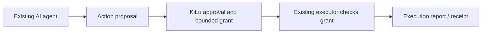

# Integrate KiLu without replacing your agent stack

**KiLu's value is the external enforcement boundary.** Existing agent models, planners and workflow engines can continue to propose actions. An integration adds authority checks to the selected side-effecting executor.

## Three commercial integration profiles

| Profile | Buyer environment | KiLu capability under evaluation | Existing evidence |
|:--|:--|:--|:--|
| **Agent infrastructure** | Tool-calling systems, browser workers, API/mutation executors | Signed action-bound grants; runtime-bound JTI; verifiable receipts | Cloud/compiled Linux Hub/Go synthetic CI |
| **Enterprise automation** | Privileged operations requiring human oversight | Independent Android approval key, bounded permissions, auditable execution | Historical R1/E2/E3.2 and CREG-003 crypto tests |
| **Edge / embedded** | Resource-constrained local execution gateways | Offline local Ed25519 grant checking without LLM policy inference | STM32H7 DeTAK hardware gate, ~7.933 ms valid-grant path |

**Agentic payments** is a possible vertical variant: an AI-initiated payment is admitted only by an independently authorized transaction path. It requires a regulated partner's approved sandbox and sector-specific integration; banking production qualification has not been asserted.

## First integration: preserve an existing workflow

A bounded technical evaluation can reuse the buyer's current agent/executor while introducing one mandatory approval/grant boundary and one independent receipt verifier.

## Acceptance conditions

1. A matching signed authorization permits the agreed test action once, under the selected runtime, toolchain, scope and time limits.
2. Changed action, missing approval, wrong runtime, expired grant or consumed JTI **fails closed** at the execution boundary.
3. A completed action yields an issuer-linked report and receipt; changed covered evidence fails independent verification.
4. The deployment makes the authority check unavoidable for the evaluated side-effecting route.
5. Latency is measured **at the actual buyer integration boundary**, not inferred from the separate AegisAI or STM32 benchmark.
6. Record customer-visible adoption effort: integration days, latency overhead, workflow interruptions, storage and operational cost.

**Evidence-to-product transition:** existing verified mechanisms support a narrow acquisition or licensing evaluation today. The buyer-specific integration is a new qualification of the selected target system, not an invitation to restart closed experiments.

[Architecture](02_ARCHITECTURE_BOUNDARIES.md) · [Previous results](04_EXECUTION_EVIDENCE.md) · [Technical buyer protocol](06_REVIEW_PROTOCOL.md).
